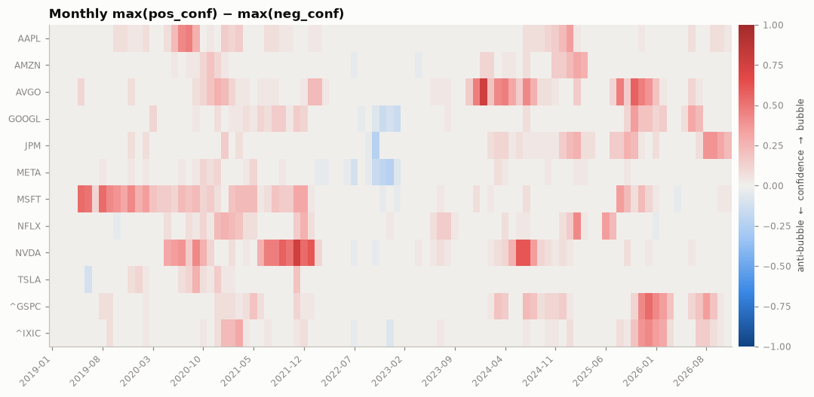
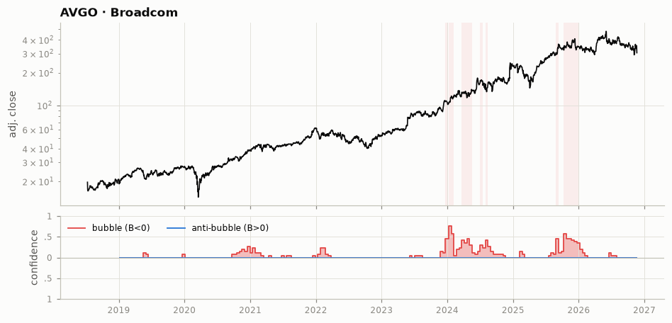

# How the bubble detector works: a plain-language guide

*For readers without a mathematics or programming background. Technical details are in
[methodology.md](methodology.md) and [tuning.md](tuning.md).*

> **Data and run used for every example in this document.** Daily prices up to **20 November
> 2026**, and the stored scan labelled `default` (run `8264c9f6`). It has an analysis date every
> 10 trading days since January 2019 for 12 instruments, 26 look-back windows per date, and
> 62,088 model fits in total. A denser scan (every 5 days, 126 windows) was still running when
> this was written, and its numbers will differ slightly.
>
> **This is a research tool. Nothing here is investment advice.**

---

## 1. The short version

* The model looks for a specific **fingerprint of speculative bubbles** in a price chart: the
  price rises *faster and faster*, and its ups and downs come *closer and closer together*.
* When that fingerprint is present, the model also estimates **when the pattern must end**. The
  estimate is a range of dates called the *critical time*.
* It checks the fingerprint over **26 different look-back periods** (6 months to 3 years). The
  share of periods that agree is the **bubble confidence**, between 0 and 1.
* **Prediction horizon:** the model places the end of a bubble typically **1 to 2½ months** after
  the analysis date (median 41 days), and almost never more than 4 months ahead.
* **What validation shows:** the model reliably recognises *overheated, accelerating* markets.
  After an alarm, prices on average kept rising for months and then fell harder than usual. It
  is **not** a reliable crash-timing tool. Its estimated end dates were usually too early, and it
  does not predict 3-month drawdowns better than a simple momentum rule.

---

## 2. What a bubble looks like to this model

### Fingerprint 1: growth that keeps accelerating

Normal growth, even fast growth, adds roughly the same *percentage* each year. On a chart with a
logarithmic price scale that is a straight line. In a bubble, the growth rate itself keeps
increasing: 20 % a year becomes 40 % then 80 %, and the line bends upwards. This
*faster-than-exponential* growth cannot go on forever. Mathematically it heads towards a point
in time where it would become infinite. That point is the **critical time**.

### Fingerprint 2: wobbles that speed up

Prices never rise in a straight line. In a bubble, the pull-backs and rebounds come at
shorter and shorter intervals as the critical time approaches. A good everyday picture is
a coin spinning on a table: as it settles, it wobbles faster and faster until it suddenly stops.

### Why would markets behave like that? Herding

The theory behind the model (Johansen, Ledoit and Sornette, around 2000) explains both
fingerprints with **imitation between investors**:

* People copy what their peers do. Buying encourages more buying, so prices accelerate.
* Copying happens in groups of groups (friends, firms, the media, whole markets). Each level reacts
  a little faster than the one below, which creates the speeding-up wobbles.
* As imitation spreads, the market becomes fragile: everyone is on the same side of the boat.
  The *risk* of a sudden reversal grows, and investors who stay in are, in effect, being paid for
  carrying that risk. That is *why* prices keep rising.

**Important:** the critical time is the moment the bubble *regime* becomes unsustainable. It
can end in a crash, in a slow decline, or simply in a sideways market. The model gives the
*most likely* end of the regime, not a crash date.

---

## 3. How the model works, step by step

### Step 1: collect prices

Daily prices for 12 instruments are downloaded from Yahoo Finance and stored in a database:
the S&P 500 and NASDAQ indices, the "Magnificent Seven" (Apple, Microsoft, Alphabet, Amazon,
NVIDIA, Meta, Tesla), plus Broadcom, JPMorgan Chase and Netflix. Prices are adjusted for
dividends and stock splits.

### Step 2: look back over one period and fit the bubble curve

Take one **analysis date** (for example 29 November 2021) and one **look-back period** (for
example the previous 500 trading days, about 2 years). The model tries to draw the bubble-shaped
curve that best matches the price path in that period.

The curve has seven settings: the critical time, the curvature of the acceleration, the speed
of the wobbles, and four scaling numbers. Four of them can be calculated exactly. The other three,
including the critical time, must be *searched for*, and the search is hard: many combinations
look almost equally good.

To search, the model uses a **genetic algorithm**, a technique inspired by evolution:

1. Start with 40 random guesses.
2. Score each guess by how closely its curve follows the prices.
3. Keep the best few. Let good guesses "mate" (mix their settings) and "mutate" (small random
   changes).
4. Repeat for up to 30 generations, then fine-tune the winner with a precise local search.

This takes about a tenth of a second per fit.

*NVIDIA on 29 November 2021. Black: the 500 trading days the model saw. Blue: the fitted
bubble curve. Red band: where the model placed the end of the bubble (9 December 2021 to 26
January 2022). Dashed grey: what happened afterwards, which the model did not see. NVIDIA had
peaked that very day and lost about two thirds of its value over the next year.*

### Step 3: reject fits that do not look like real bubbles

Any curve can be forced through any data, so every fit must pass five sanity checks drawn from
historical bubbles:

| Check | Plain meaning |
|---|---|
| Acceleration in a realistic range | not a straight line, not a vertical wall |
| Wobble speed in a realistic range | real wobbles, neither a slow trend nor noise |
| End date close to "now" | the end must fall within a short time after the analysis date, and not *on* the first possible day (a sign the search got stuck) |
| Wobbles not too large compared with the trend | the "crash risk" implied by the curve must stay positive |
| Enough wobbles in the data | at least 2½ half-swings must actually be visible, not just extrapolated |

A fit that passes all five is **qualified**. In the current run, 3.8 % of all fits qualify.

### Step 4: repeat with 26 different look-back periods

A pattern seen in only one look-back period could be a coincidence. So steps 2–3 are repeated for
look-back periods of 125, 150, … up to 750 trading days (6 months to 3 years). The **bubble
confidence** for that date is the share of the 26 periods whose fit is qualified and points
*upwards*.

*The same NVIDIA date. Each dot is one look-back period. Red dots passed the checks. 20 of 26
periods agree, giving a confidence of 20 / 26 = 0.77, and most of them place the end between
December 2021 and February 2022.*

The model also reports the **estimated end window**: the middle half of the end dates of all
qualified fits (the 25th to 75th percentile).

### Step 5: repeat every two weeks, for every instrument

Steps 2–4 run every 10 trading days from 2019 onwards for all 12 instruments. The result is a
confidence time series per instrument, stored in the database and shown in the notebooks.

There is also a mirror-image signal, the **anti-bubble confidence**, for prices falling faster and
faster. In this period it was rare and weak.

---

## 4. Reading the output

| Confidence | Meaning | How often (current run) |
|---|---|---|
| 0 | no look-back period shows the fingerprint | most dates |
| 0.05 – 0.3 | a few periods see it; weak, often noise | common in strong uptrends |
| **0.3 – 0.6** | many periods agree: an **alarm**; the market is in an accelerating, fragile phase | 89 of 2,388 ticker-dates (3.7 %) |
| above 0.6 | broad agreement across time scales; a strong bubble signature | 7 ticker-dates (NVDA in Nov 2021 – Jan 2022 and Jun – Jul 2024, AVGO in Jan 2024) |

The **estimated end window** answers "if this is a bubble, when does the pattern run out?".
A narrow window means the look-back periods agree, and a wide window means they disagree.

*Every instrument, every month since 2019. Red: bubble signature. Blue: anti-bubble signature.
The clusters are MSFT in 2019–20, NVDA in late 2021 and mid-2024, AVGO in 2024–25, and the indices
in late 2025.*

---

## 5. The prediction horizon

The model forecasts **one thing: when the accelerating regime is likely to end** (the critical
time). It does not forecast a price level, the size of a fall, or what happens after the end.

### Built-in limits

* The model is only allowed to place the end **after** the analysis date. For a fit to count as a
  signal, the end must lie within **20 % of the look-back length** after the analysis date:
  * 6-month look-back: at most about **5 weeks** ahead
  * 3-year look-back: at most about **7 months** ahead
* So the horizon is short by construction: weeks to a few months, never years.

### Measured in the current run

| Look-back period | Median distance from analysis date to estimated end | Middle half |
|---|---|---|
| short (125–250 days) | 19 days | 9 – 34 days |
| medium (275–500 days) | 38 days | 17 – 66 days |
| long (525–750 days) | 56 days | 21 – 99 days |
| **all qualified fits** | **41 days** | **17 – 76 days** (90 % within 119 days) |

**In plain words: when the model fires, it says "this pattern should end within roughly 1 to 2½
months".**

### What actually happened: the model was early

Across the 20 completed alarm episodes in the current run (an episode is a run of dates with
confidence ≥ 0.3 for the same instrument; figures from `lppl validate`, test 6):

* The price kept **rising** after the first alarm: median **+27 %** up to its subsequent top.
* That top came a median **110 trading days (about 5 months)** after the first alarm. In 6
  episodes, the price was still near its high 6 months later.
* After that top, the price fell a median **−25 %** within the following 6 months.
* The actual top fell inside the model's estimated end window in only **1 of the 20** episodes
  (Broadcom, spring 2024). NVIDIA in 2021 missed it by just 10 days.

So the realistic reading of the horizon is that **the alarm arrives months before the top, and the
estimated end date should be read as "the regime is late-stage", not as a calendar date.**

### The horizon used to validate the model

To score the model statistically (§6.5), an alarm counts as correct if a large fall follows within
**3 months (63 trading days)**. "Large" is measured relative to each instrument's normal volatility:
about 12 % for the S&P 500, 19 % for Microsoft, 32 % for NVIDIA and 37 % for Tesla.

---

## 6. How the model is validated

Validation happens in layers, from "is the arithmetic right?" to "does it work on data it has never
seen?".

### 6.1 Does the arithmetic work? (automated tests)

About 100 automated tests run on every change. The most important ones generate **artificial bubble
prices with a known end date**, add realistic noise, and check that the model finds the end
again: it does so to within about 18 days in at least 95 % of trials. Other tests check that a
random walk (a price with no bubble) scores lower than an artificial bubble, and that results
do not depend on how many processors are used.

### 6.2 Is the curve-fitting search good enough?

The genetic algorithm was compared with two other well-known search methods on 24 real price windows,
and tuned on a benchmark of 48 windows where the best possible fit was found by a much more expensive
search. The default search reaches within 0.5 % of the best possible fit on average. An automatically
tuned version reaches within 0.15 % while using 37 % less computation
([tuning.md](tuning.md) §10).

### 6.3 Can anyone reproduce the results?

Every run stores its exact settings, the code version, and a fingerprint (checksum) of the price data.
A complete run was deleted and recomputed from scratch inside the Docker container. All
2,751 stored results came out identical ([reproducibility.md](reproducibility.md)).

### 6.4 Does it recognise famous bubbles? (case studies)

| Episode | Top | Highest confidence before the top | Estimated end window | Afterwards |
|---|---|---|---|---|
| NASDAQ dot-com | 10 Mar 2000 | 0.15 (Dec 1999) | 22 Feb – 28 Mar 2000 ✔ contains the top | −59 % in 12 months |
| S&P 500 before 2008 | 9 Oct 2007 | 0.42 (Jul 2007) | 25 Sep – 13 Oct 2007 ✔ contains the top | −37 % |
| NVIDIA 2021 | 29 Nov 2021 | 0.77 (on the day of the top) | 9 Dec 2021 – 26 Jan 2022 (10 days late) | −66 % |
| NVIDIA 2024 | 18 Jun 2024 | 0.62 (11 Jun 2024) | 28 Jul – 24 Aug 2024 (the fall came in July–August) | −27 % by early August |
| Tesla 2021 | 4 Nov 2021 | 0.19 (weak) | Jan – Feb 2022 | −50 %, essentially missed |

The famous cases look convincing, but they were chosen *because* they are famous. The real test is
6.5 and 6.6.

> The full battery of accuracy tests (significance intervals, placebo, walk-forward, simulated
> bubble-free prices, backtest) is run by `lppl validate` and described in
> [validation.md](validation.md). Its verdict for the current run is summarised in §6.7.

### 6.5 Does it predict out of sample? (the statistical test)

The fairest test asks: *on dates the model was never tuned on, does a high confidence come before
large falls more often than chance?* Dates from 2019–2023 were used for tuning, and 2024 onwards was
kept aside for checking. Skill is measured with *average precision*: 1 is perfect, and a random
guess scores the share of dates that are followed by a large fall (the base rate).

| | 2019–2023 (used for tuning) | 2024 onwards (unseen) |
|---|---|---|
| random guess (base rate) | 0.147 | 0.116 |
| simple momentum rule ("it went up a lot recently") | 0.147 | **0.132** |
| bubble model, standard settings | 0.156 | 0.120 |
| bubble model, settings tuned for 2019–2023 | 0.230 | 0.115 |

**Verdict:** on unseen data the model is barely better than a random guess, and worse than the
simple momentum rule, at predicting a large fall within 3 months. Tuning the settings made the past
look much better and the future slightly worse, a textbook case of over-fitting. This agrees with the
scientific criticism of the method ([methodology.md](methodology.md) §9).

### 6.6 What happens after an alarm, compared with ordinary days?

| Median over the next months | After an alarm (68 dates) | On all other dates (2,076) |
|---|---|---|
| rise until the next 6-month top | **+30 %** | +19 % |
| fall after that top (6 months) | **−28 %** | −17 % |
| return over 3 months | +8.4 % | +6.3 % |
| worst fall within 3 months | −14.6 % | −11.1 % |

Alarms mark periods that are **hotter on the way up and harsher on the way down** than normal,
which is what the bubble theory describes. But the timing is too vague to trade on, and the sample
(68 alarm dates in about 23 episodes) is too small for firm conclusions.

### 6.7 The full validation suite (`lppl validate`)

| Question (5 % level) | Answer |
|---|---|
| Better than a random guess? | no: an alarm was followed by a large fall *less* often (9.5 %) than a random date (13.2 %) |
| Better than a simple momentum rule? | no, on all dates and on 2024+ |
| Does the *timing* of the signal matter? | no: randomly time-shifted copies do as well (p = 0.40) |
| Does a higher confidence mean more falls? | no clear pattern |
| Does re-tuning on the past help the next year? | only in 1 of 6 years |
| Does it fire more on real prices than on simulated prices without bubbles? | not significantly (4.5 % vs 3.9 %, p = 0.18) |
| Would cutting exposure on alarms have helped? | no: about 5 % behind buy & hold over 2019–2026 |

Details, charts and caveats are in [validation.md](validation.md) and notebook `05_validation`.

---

## 7. Examples from the current run

### 7.1 Today's readings (20 November 2026)

| Instrument | Confidence today | Highest in last 60 days | Estimated end window |
|---|---|---|---|
| JPMorgan Chase | 0.12 | 0.38 | 10 – 31 Jan 2027 |
| Apple | 0.04 | 0.08 | 19 Dec 2026 |
| S&P 500 | 0.00 | 0.12 | – |
| NASDAQ | 0.00 | 0.04 | – |
| Microsoft | 0.00 | 0.04 | – |
| NVIDIA, Alphabet, Amazon, Meta, Tesla, Broadcom, Netflix | 0.00 | 0.00 | – |

**No instrument shows a strong bubble signature today.** JPMorgan has the strongest recent signal, and
it is fading.

### 7.2 A live example: the S&P 500, August 2026

* On **27 August 2026** the confidence reached **0.35**. The estimated end window was
  **16 September – 24 November 2026**.
* The index rose another 1 % to its top on **6 October 2026**, inside that window, and has since
  fallen **11.6 %** (to 6,910 on 20 November).
* An earlier alarm in **December 2025** (0.54, end window February–March 2026) came about
  **10 months too early**: the index rose another 14 % before that October top.
* The 3-month check for the August alarm ends around 25 November. With the S&P 500's threshold
  of about 12 %, it is not yet decided whether this counts as a "hit".

### 7.3 A live example: JPMorgan Chase, autumn 2026

* Alarms from **27 August to 9 October 2026**, peaking at 0.38. The estimated end window on
  27 August was **3 – 18 September**.
* JPMorgan peaked on **3 September 2026** and is now **13.8 %** lower.
* Today's reading (0.12, end window January 2027) shows the signal fading.

These two recent examples look good. The systematic test in §6.5 shows that such successes are not
reliable, so they should be read as illustrations, not proof.

### 7.4 An early alarm: Broadcom, January 2024

* Confidence 0.77 on 9 January 2024, with an end window of late January to mid-February.
* Instead, Broadcom rose **another 70 %** until 17 June 2024, then fell 25 %. Selling at the alarm
  would have been very costly.

### 7.5 All alarm episodes in the current run

| Instrument | First alarm | Peak confidence | Estimated end window (at peak) | Next 6-month top | Rise to top | Fall after top |
|---|---|---|---|---|---|---|
| MSFT | 16 May 2019 | 0.54 | 22–24 May 2019 | 13 Nov 2019 | +15 % | −8 % |
| MSFT | 3 Feb 2020 | 0.35 | 13 Feb – 25 May 2020 | 3 Aug 2020 | +25 % | −7 % |
| NVDA | 28 May 2020 | 0.42 | 9–16 Nov 2020 | 6 Nov 2020 | +72 % | −20 % |
| AAPL | 10 Jul 2020 | 0.46 | 28 Aug – 30 Oct 2020 | 28 Dec 2020 | +43 % | −15 % |
| NASDAQ | 1 Mar 2021 | 0.31 | 22–31 Mar 2021 | 27 Aug 2021 | +11 % | −14 % |
| **NVDA** | 8 Jul 2021 | **0.77** | 9 Dec 2021 – 26 Jan 2022 | **29 Nov 2021** | +68 % | **−52 %** |
| MSFT | 29 Nov 2021 | 0.31 | 21 Dec 2021 – 5 Jan 2022 | 10 Dec 2021 | +2 % | −29 % |
| AVGO | 22 Dec 2023 | 0.77 | 26 Jan – 12 Feb 2024 | 17 Jun 2024 | +64 % | −25 % |
| AVGO | 21 Mar 2024 | 0.46 | 5 May – 10 Jul 2024 | 17 Jun 2024 | +36 % | −25 % |
| NVDA | 3 Jun 2024 | 0.62 | 1–24 Aug 2024 | 7 Nov 2024 | +29 % | −37 % |
| AVGO | 2 Jul 2024 | 0.42 | 3 Oct – 2 Dec 2024 | 16 Dec 2024 | +51 % | −41 % |
| AAPL | 7 Jan 2025 | 0.35 | 3–14 Feb 2025 | 24 Feb 2025 | +2 % | −30 % |
| AMZN | 21 Feb 2025 | 0.31 | 10 Mar – 11 Apr 2025 | 31 Jul 2025 | +8 % | −10 % |
| NFLX | 21 Feb 2025 | 0.42 | 3 Mar – 7 Apr 2025 | 30 Jun 2025 | +33 % | −31 % |
| NFLX | 17 Jun 2025 | 0.35 | 7–19 Jul 2025 | 30 Jun 2025 | +10 % | −31 % |
| MSFT | 28 Aug 2025 | 0.35 | 4–9 Sep 2025 | 28 Oct 2025 | +6 % | −34 % |
| AVGO | 28 Aug 2025 | 0.58 | 28 Oct – 12 Nov 2025 | 10 Dec 2025 | +34 % | −29 % |
| GOOGL | 10 Oct 2025 | 0.35 | 16–28 Oct 2025 | 2 Feb 2026 | +45 % | −20 % |
| S&P 500 | 7 Nov 2025 | 0.54 | 5 Feb – 22 Mar 2026 | 11 May 2026 | +10 % | −2 % |
| NASDAQ | 7 Nov 2025 | 0.42 | 16 Jan – 10 Feb 2026 | 11 May 2026 | +14 % | −7 % |
| GOOGL | 16 Jun 2026 | 0.31 | 7–9 Jul 2026 | 4 Aug 2026 | +1 % | −30 % |
| S&P 500 | 27 Aug 2026 | 0.35 | 16 Sep – 24 Nov 2026 | (6 Oct 2026) | +1 % | −12 % so far |
| JPM | 27 Aug 2026 | 0.38 | 3–18 Sep 2026 | (3 Sep 2026) | +2 % | −14 % so far |

*"Next 6-month top" is the highest price within 126 trading days after the first alarm. "Fall
after top" is the largest decline within 6 months after that top. The last two rows are still in
progress.*

The pattern is that alarms cluster in strong rallies. The rally usually continues, sometimes for
months, and a sharp correction follows. The model gets the *character* of the market right and the
*timing* wrong.

---

## 8. What the model can and cannot tell you

| It **can** | It **cannot** |
|---|---|
| flag that a price is in an accelerating, herd-driven phase | tell you the day, or even the month, a bubble ends |
| show whether that verdict is robust across 6-month to 3-year views | tell you how far the price will fall |
| give a rough window for when the pattern runs out (weeks to months) | predict 3-month drawdowns better than a simple momentum rule (tested) |
| compare many instruments on one consistent scale | account for news, earnings, interest rates or anything outside the price chart |

Sensible uses: a **risk thermometer** that tells you a market is running hot, a prompt for closer
analysis, and a research tool for studying bubbles. Unsuitable uses: buy and sell signals, or
deciding to short a stock.

---

## 9. Glossary

| Term | Meaning |
|---|---|
| **Analysis date** | the "today" from which the model looks back; it never sees later prices |
| **Look-back period (window)** | how much history one fit uses: 125 to 750 trading days |
| **Critical time / end of bubble** | when the accelerating pattern would become unsustainable |
| **Estimated end window** | the middle half of the critical times from all qualified look-back periods |
| **Qualified fit** | a fit that passes all five realism checks |
| **Bubble confidence** | the share of look-back periods with a qualified, upward-bubble fit (0 to 1) |
| **Anti-bubble confidence** | the same for accelerating *falls* |
| **Alarm** | confidence of 0.3 or more |
| **Genetic algorithm** | an evolution-inspired search for the best-fitting curve |
| **Base rate** | how often a large fall happens anyway, the score of a random guess |
| **Average precision** | a 0–1 score of how well high confidence lines up with later large falls |
| **Over-fitting** | settings that describe the past well but do not carry over to new data |

---

## 10. Where to go next

* [model_presentation.md](model_presentation.md): slide-style summary with more charts
* [methodology.md](methodology.md): the full theory, the equations, and the scientific criticism
* [tuning.md](tuning.md): how the settings were tuned and tested out of sample
* `notebooks/03_bubble_indicator_dashboard.ipynb`: interactive charts for every instrument
* `lppl report`: today's readings from the command line
