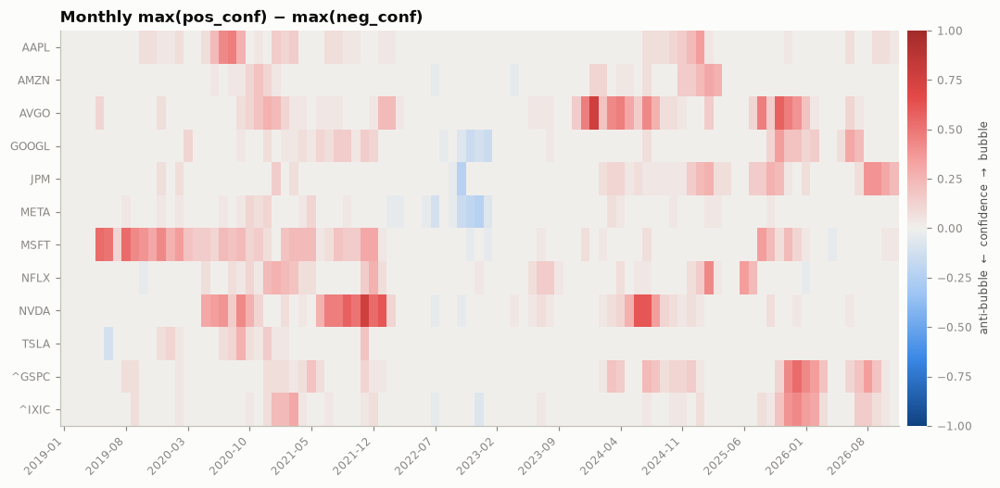
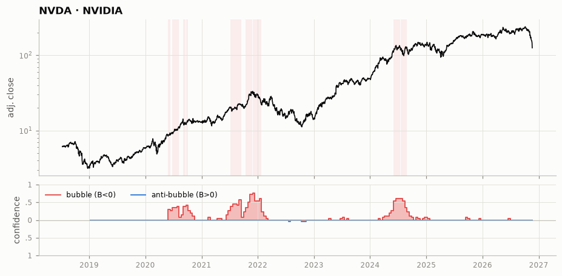
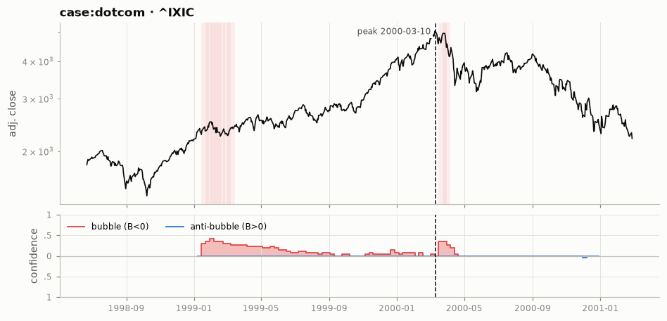
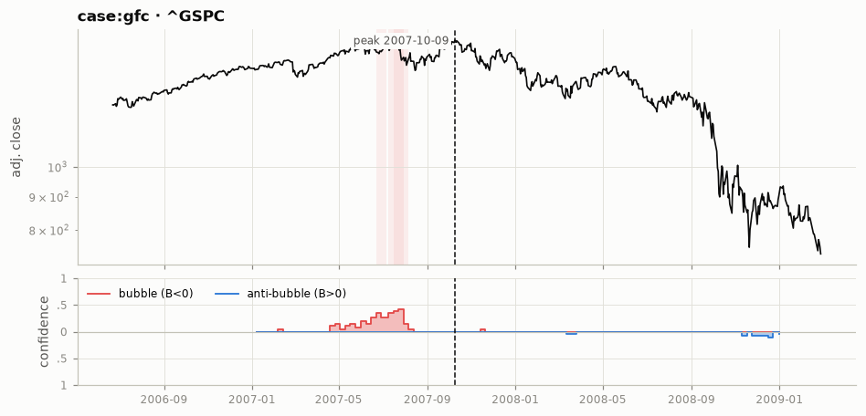
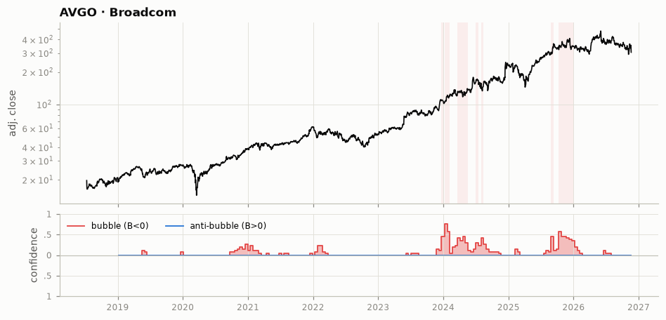

# Presenting the model: LPPLS bubble detection with a genetic algorithm

*A slide-style walkthrough. Each `---` section is one slide. The figures come from the
executed notebooks (`notebooks/03_bubble_indicator_dashboard.ipynb`,
`notebooks/04_ga_diagnostics_and_benchmark.ipynb`).*

---

## 1. The question

> Is the price rise in an asset **accelerating in a way that cannot last**, and if so,
> roughly **when** does the regime end?

- Bubbles are not just "high prices". They show **faster-than-exponential growth**
  together with **accelerating oscillations**.
- The LPPLS model turns both into a 7-parameter curve with a **critical time `tc`**.
- We scan 12 instruments (S&P 500, NASDAQ, the Magnificent Seven, plus AVGO, JPM and NFLX) every two weeks since 2019,
  and look back at four historical episodes.

---

## 2. Intuition

- **Herding.** Traders imitate each other. As imitation strengthens, the system approaches
  a *critical point* where a small shock can trigger a collective move.
- **No free lunch.** If the probability of a crash rises, rational holders must be paid
  for that risk, so the **price has to rise faster** (JLS no-arbitrage condition).
- **Hierarchies.** Imitation happens within and between groups of different sizes, which produces
  oscillations that speed up in log time (*log-periodicity*).

---

## 3. The equation

```
ln p(t) = A + B (tc − t)^m + C1 (tc − t)^m cos(ω ln(tc − t)) + C2 (tc − t)^m sin(ω ln(tc − t))
```

| | |
|---|---|
| `tc` | critical time: the most likely end of the bubble regime |
| `m ∈ (0,1)` | how sharply growth accelerates |
| `ω` | how fast the oscillations accelerate |
| `B < 0` | upward (positive) bubble; `B > 0`: downward anti-bubble |
| `A, B, C1, C2` | solved **exactly** by least squares once `(tc, m, ω)` are fixed |

So the optimisation problem is only **3-dimensional**, but it is very multi-modal.

---

## 4. Calibration with a genetic algorithm

```mermaid
flowchart LR
    A[Random population<br/>40 × (tc, m, ω)] --> B[Evaluate all at once:<br/>OLS for A,B,C1,C2 → SSE]
    B --> C{Stop?<br/>30 gens or<br/>10 w/o progress}
    C -- no --> D[Tournament<br/>selection k=3]
    D --> E[BLX-α crossover<br/>p=0.9]
    E --> F[Gaussian mutation<br/>σ decays 5%/gen]
    F --> G[Keep 3 elites]
    G --> B
    C -- yes --> H[Nelder–Mead polish<br/>of the best]
    H --> I[Fit + qualification checks]
```

- About 1,300 objective evaluations per window, about 90 ms each.
- Deterministic: every window has its own seed derived from `(seed, ticker, date, window)`.

---

## 5. From one fit to a signal

1. For an analysis date `t2`, fit **26 windows** of 125 to 750 trading days.
2. Keep fits that pass the **qualification filters**:
   `0.1 ≤ m ≤ 0.9`, `2 ≤ ω ≤ 25`, `tc` close to `t2` (but not pinned at the search bound),
   damping ≥ 0.5, ≥ 2.5 oscillations.
3. **Positive confidence** = share of windows qualified with `B < 0`.
   **Negative confidence** = share qualified with `B > 0`.
4. Report the interquartile range of `tc` across the qualified windows.

A reading of 0.6 means that 60 % of the time scales independently show a bubble
signature. It is a robustness score, **not** a crash probability.

---

<!-- RESULTS:BEGIN -->
## 6. The data and the run

- Daily adjusted closes from Yahoo Finance, 1995-01-03 to 2026-11-20. Coverage starts later for listings that came later
  (GOOGL 2004, AVGO 2009, TSLA 2010, META 2012).
- **Default run:** 12 tickers × 199 analysis dates (every 10 trading days since 2019) × 26 windows,
  = **62,088 GA calibrations**, about 1 h on 2 CPUs in Docker (114 ms and about 1,350 evaluations per fit).
- 3.8 % of all window fits pass the qualification filters.

---

## 7. Where the model saw bubbles (2019 – Nov 2026)



- **NVDA** is the most bubble-prone name: confidence ≥ 0.3 on 12 % of analysis dates, followed by
  MSFT (8.5 %) and AVGO (8 %). META and TSLA never reached 0.3 in this period.
- Red clusters: MSFT 2019–20, NVDA late 2021 and mid-2024, AVGO 2024–25, and the indices
  in late 2025.
- Anti-bubble (blue) signatures are rare and weak. They appear mostly in the 2022 drawdown
  (META, GOOGL, JPM).

---

## 8. Hit: NVIDIA, November 2021



- On **2021-11-29**, the day of the closing high, positive confidence was **0.77** (20 of
  26 windows), with `tc` interquartile range 2021-12-09 → 2022-01-26.
- The stock fell **66 %** over the following year.
- In **June–July 2024** the signal fired again (0.62), with `tc` in August 2024. NVDA dropped about 27 % into
  early August, then recovered.

---

## 9. Historical case studies (analysis every 5 trading days)

| Episode | Peak | Max `pos_conf` in 180 days before the peak | `tc` interquartile range at that date | 12-month drawdown |
|---|---|---|---|---|
| NASDAQ dot-com | 2000-03-10 | 0.15 (1999-12-20) | **2000-02-22 → 2000-03-28** | −59 % |
| S&P 500 before the 2008 crisis | 2007-10-09 | 0.42 (2007-07-23) | **2007-09-25 → 2007-10-13** | −37 % |
| NVIDIA AI rally | 2024-06-18 | 0.62 (2024-06-11) | 2024-07-28 → 2024-08-24 | −30 % (Aug 2024 low) |
| Tesla | 2021-11-04 | 0.19 (2021-11-03) | 2022-01-22 → 2022-02-06 | −50 % |

- For 2000 and 2007 the **`tc` window contained the actual peak**, even though the
  *confidence* was low to moderate.
- For TSLA, the very fast run-up of 2020 did not fit the LPPLS shape well. The signal was weak and
  late, which makes it a clear miss.




---

## 10. False positives are real



- **AVGO, January 2024:** confidence 0.77 with `tc` in late January to mid-February. The stock then rose
  **another 21 %** by the end of April, with at most a 14 % pullback within 6 months.
- **S&P 500, December 2025:** confidence up to 0.54 with `tc` around February 2026. The index kept rising
  until **2026-10-06** and is 12 % below that high as of 2026-11-20. The signal was about 8 months
  early.

The indicator identifies a *regime*: super-exponential growth with log-periodic structure.
It does not identify a date, and strong secular trends can stay in that regime for a long time.

---

## 11. Current reading (2026-11-20)

| Ticker | `pos_conf` | Max over the last 60 days | `tc` interquartile range |
|---|---|---|---|
| JPM | 0.12 | 0.38 | 2027-01-10 → 2027-01-31 |
| S&P 500 | 0.00 | 0.12 | — |
| AAPL | 0.04 | 0.08 | — |
| all others | 0.00 | ≤ 0.04 | — |

There is no strong bubble signature in the universe at the latest date. **JPM**, included as a
non-tech control, shows the most persistent recent signal (0.3–0.4 from late August to early October 2026, fading since).

---

## 12. Optimiser benchmark (notebook 04, 24 random real windows)

| Method | Median ms / window | Evaluations | Found the best SSE | Worst excess SSE |
|---|---|---|---|---|
| **GA (ours)** | **113** | 1,352 | 79 % | 4.7 % |
| Differential evolution (SciPy) | 235 | 4,242 | 83 % | 6.9 % |
| Multistart Nelder–Mead (20 starts) | 956 | 3,292 | 96 % | 2.9 % |

- The GA is the fastest at comparable quality. The misses happen on windows without clear
  LPPLS structure, and those fits are rejected by the filters anyway.
- Seed stability: on a well-defined window, `tc` varies by about 2 seconds across 20 seeds (GA)
  vs. about 10 minutes (DE).
- The Nelder–Mead polish matters more than the population size (sensitivity table in notebook 04).
<!-- RESULTS:END -->

---

## 13. What the statistical tests say

The case studies above are illustrations. The formal tests are in [validation.md](validation.md)
and [combined_model.md](combined_model.md).

| test | 12 US stocks, 2019–2026 | 12 US stocks, 1987–2026 | 16 burst-bubble assets, 1987–2026 |
|---|---|---|---|
| alarm followed by a large 3-month fall | 9.5 % (random date: 13.2 %) | 12.9 % (random date: 14.1 %) | **30 %** (random date: 16 %) |
| timing beats a time-shifted placebo | no (p = 0.40) | no (p = 0.24) | **yes (p = 0.001)** |
| higher confidence = more falls | no | no | **yes** (15 % → 20 % → 30 % → 37 %) |
| fires more on real than on bubble-free prices | no (p = 0.18) | **yes (p = 0.004)** | **yes (p = 0.005)** |
| pre-registered labels passing after Holm correction | 0 of 4 | 1 of 4 (major tops) | **3 of 4** |
| top inside the predicted `tc` window | 0 of 20 | 0 of 78 | 2 of 66 (no better than permuted windows) |
| improves a walk-forward forecast built on market features | no | no (0 of 6) | **no** (0 of 6 tests) |
| refined signals (short scale, agreement, residual test, Lagrange) improve it | no | no | no |


**In one sentence:** LPPLS recognises bubble-shaped rallies on assets that really had bubbles,
and its alarms roughly double the chance of a large fall. But it does not time the crash, and the
information it adds over simple momentum, volatility and drawdown statistics is too small to
improve an everyday forecast.

## Limitations (read before acting on any of this)

- **`tc` is poorly identified.** Treat it as a window of weeks to months, not a date.
- **False positives.** Strong secular trends can look like bubbles for months.
- **Case studies are illustrations.** The out-of-sample scoring is in §13, `docs/validation.md` and
  `docs/combined_model.md`.
- **Survivorship.** The Magnificent Seven are today's winners by construction.
- **Not investment advice.**
